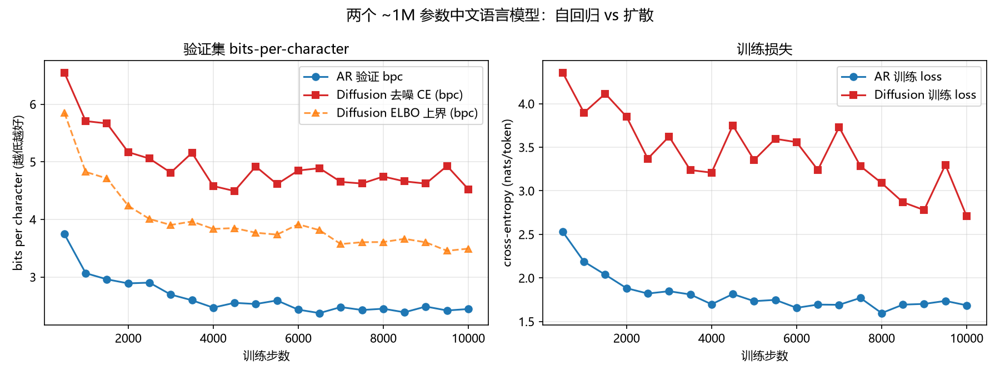

# 两个 ~1M 参数中文语言模型：自回归 vs 扩散

## 1. 任务

在纯 CPU 本机上，用同一份中文语料、同样的参数量和同样的训练预算，训练两个约 1M 参数的语言模型：

- **AR**：decoder-only Transformer，因果注意力，标准的下一字符预测。
- **Diffusion**：同样的 backbone，双向注意力，吸收态（masked）离散扩散，目标是还原被随机掩码的字符本身。

## 2. 语料

| 项目 | 值 |
|---|---|
| 来源 | `hf-mirror.com/datasets/adam89/TinyStoriesChinese` |
| 原始大小 | 2.49 GB (tar.gz, 8 个 jsonl 分片) |
| 使用的字段 | `story_zh`（中文译文） |
| 训练 token | 77,882,582 |
| 验证 token | 1,549,282 |
| 词表 | 字符级，3490 个（含 eos/mask/pad） |

## 3. 模型与训练设置

| 超参 | AR | Diffusion |
|---|---|---|
| 参数量 | 1,001,392 | 1,001,392 |
| 层数 / 头数 / d_model / d_ff | 5 / 4 / 112 / 320 | 同左 |
| 位置编码 | RoPE | RoPE |
| 注意力 | 因果 | 双向 |
| 归一化 | RMSNorm (pre-norm) | 同左 |
| 词嵌入 | 与输出层共享 | 同左 |
| 训练步数 | 10000 | 10000 |
| batch × seq_len | 32 × 256 | 同左 |
| 训练 token 数 | 81,920,000 | 81,920,000 |
| 墙钟时间 | 153.33 分钟 | 157.9 分钟 |
| 吞吐 | ~8.9k tok/s | ~8.3k tok/s |
| 优化器 | AdamW (0.9, 0.95), wd 0.01 | 同左 |
| 学习率 | 3e-3, warmup 400 + cosine → 2e-4 | 同左 |
| 硬件 | CPU, 8 线程/进程, 两进程并行 | 同左 |

## 4. 结果

| 指标 | AR | Diffusion |
|---|---|---|
| 验证 bits/char | **2.3506** | 3.5114 (ELBO 上界) |
| 验证 nats/token | 1.6293 | 2.4339 |
| 困惑度（每字符） | 5.10 | 11.40 |

扩散相对自回归的差距：**+1.1608 bits/char**。

说明：AR 的 `val_bpc` 与扩散的 `val_elbo_bpc` 都是每字符负对数似然的估计，两者可以直接比较；扩散的去噪 CE（随机掩码率下的 CE）**不是**上界，不能与 AR 的 bpc 并列。

## 5. 生成样例


#### 自回归模型 (AR)

参数量 1,001,392 · 训练 10000 步 · temp 0.85 · top_k 50

**1. 提示：`从前，有一个小女孩`**

```
从前，有一个小女孩叫莉莉。她有一个大而干净的玩具，就是一只魔法猫。每天她都会和其他猫一起玩，给莉莉一个大大的拥抱。

有一天，莉莉的妈妈说：“莉莉，我们需要把玩具留在自己身边。” 莉莉很失望，但她想要那个漂亮的猫一起玩。她问妈妈是否可以给她买新玩具。

妈妈说：“当然可以，莉莉。因为我们可以给你买个新的玩具。” 莉莉很高兴能够帮她的玩具。他们买了一些玩具，然后回家了。莉莉非常高兴，感谢妈妈给她的玩具。结束。
```

**2. 提示：`一天，小兔子在森林里`**

```
一天，小兔子在森林里散步时，看到了一只小鸟。小鸟很惊讶，因为它可以帮助小鸟感觉更好。

小兔子对小鸟说：“我能帮助你找到它吗？”小鸟点点头，于是小鸟飞走了。小鸟非常开心，飞走了，感谢小鸟的帮助。

小鸟感谢小鸟的帮助，小鸟飞起飞去找小鸟找到了它的家。小鸟带着小鸟走得太远，一起找到小鸟。小鸟感谢小鸟帮助了小鸟，小鸟一起找了小鸟。小鸟很高兴，感谢了小鸟的帮助。
```

**3. 提示：`妈妈对小熊说：`**

```
妈妈对小熊说：“让我们给它讲一个故事吧！”

小熊非常高兴能学到新知识。他在房间里转圈，还看到了星星。其他动物在外面看着他，因为这是一个公园。大家都听到他的笑声，笑得很开心。

小熊和其他动物一起玩耍，度过了很愉快的时光。他们学到了在公园里很重要，即使是你们的聪明方法也能听到。
```

_AR 生成耗时 2.5s_


#### 扩散模型 (masked diffusion)

参数量 1,001,392 · 训练 10000 步 · 64 步去噪 (conf) · temp 1.0 · top_k 50

**1. 提示：`从前，有一个小女孩`**

```
从前，有一个小女孩叫莉莉莉。她喜欢在外面玩玩具玩具。有一天，她在外面玩发现了一个很大的玩具，非常漂亮。

莉莉的妈妈妈说：“妈莉，我们给我的玩具了！”。”
莉莉非常妈妈说：“不，莉莉，我喜欢玩你的玩具。”

莉莉想玩她的玩她的玩具玩她的玩具。于是，莉莉的妈妈让她的玩具玩一个玩玩具玩具。

最后，莉莉的妈妈把她的玩具玩玩具。她把玩具放在她的玩具时，莉莉成示了她的玩具玩玩具。
```

**2. 提示：`一天，小兔子在森林里`**

```
一天，小兔子在森林里散步。他子觉得很害怕，，但他知道该怎么办。


小兔子想帮助兔子。兔子想帮助兔子，但是找不到小兔子。小兔子想帮助兔子。兔子说：“你好，小兔子。”

兔子回答：““当然可以帮你，小兔子。” 兔子和兔子一起了，然后和兔子成为了最好的朋友。兔兔子和兔子和小兔子一起玩耍。

兔子和兔子成为了朋友，成为了好好朋友。他们成为了朋友，一起玩耍了玩天。。他们非常开心。
```

**3. 提示：`妈妈对小熊说：`**

```
妈妈对小熊说：“我们爱你，妈妈。”她的妈妈说。

妈妈说：““谢谢你，妈妈。”

她妈妈给她拥抱了。她说：“谢谢！谢谢谢谢你，妈妈。”

她妈妈笑了笑着说：“谢谢，妈妈，妈妈，妈妈。”她的妈妈看到了一圈。

“妈妈妈妈，你想玩它吗？”

妈妈说：“当然然可以，妈妈。但是我的妈妈。”

妈妈妈妈妈说：“对不起，妈妈。我丢了。但是有的。它太好了。”。

“不，妈妈妈，妈妈。这是我的妈妈。” 妈妈说。

妈妈说：“不，，妈妈！我们一起玩吧。”
```

_扩散生成耗时 5.0s_


##### 无条件生成（全掩码起步）

**Sample 1**

```
们说。

他们说他们很抱歉。他们拥抱歉。他们拥抱了他们。他们看着他们。他们看着他们。他们看着他们的声音。他们看着他们。他们很害怕。他们笑了。他们看着他们。他们拥抱他。他们看到他们的声音。他们看着他们。他们。他们看着他们。他们说他们很害怕。他们和他们。他们喊道。他们很生气。他们说他们很抱歉。他们拥抱歉。他们拥抱他们。他们道歉了。他们抱歉。他们很抱歉。他们们生气了。他们很生气。他们很生气。他们很生气。他们拥抱他们。他们很生气。他们抱歉了。他
```

**Sample 2**

```
莉莉莉莉和莉莉。她说谢莉莉，那是莉莉。“你好，莉莉。。你喜欢玩吗？”莉莉说。

“我们喜欢莉莉，莉莉。”莉莉说。

“不，莉莉！”莉莉说。

“不，莉莉。”莉莉说。他们很好了。

“好的，莉莉莉。”莉莉说。

“好的，妈妈。我们可以和你一起玩。”

莉莉和莉莉也拥抱了莉莉。她们笑了。他们拥抱了莉莉。他们都笑了。他们笑笑，笑，笑了。他们拥抱了莉莉，感到骄傲。。“谢谢你，妈妈和莉莉。我们可以一起玩吧。”
```

## 6. 训练曲线



## 7. 实现中修掉的关键 bug

1. **扩散训练目标用错。** 吸收态扩散的去噪目标是序列本身 `model(x, x)`，最初写成了 `model(x, y)`（y 是右移一位的下一 token）。被掩码的位置 i 的目标变成 `x[i+1]`，而 `x[i+1]` 并未被掩码、模型直接可见，于是它学会了“抄右邻居”。这个退化目标的 loss 很好看（3.9），采样却全是「莉莉莉莉莉」。
2. **扩散推理时重新掩码。** `DiffusionLM.forward` 在 `targets is None` 之前就随机生成 mask 并覆盖输入，导致 `generate()` 每一步都把上一步刚解码好的画布重新打乱。修复后同一个 checkpoint 在 t=0.05 的 loss 从 3.926 降到 1.775 bpc，样本立刻通顺。
3. **ELBO 估计量重尾。** `1/t` 的蒙特卡洛形式下，t≈0.01 的单个 token 权重是 100，会带偏整批均值（表现为“去噪 CE 变好、ELBO 反而变差”这种不可能现象）。改用代数等价的比率估计 `mean_masked * n_masked/(T*t)`，每个 t 的权重都接近 1。
4. **解码器是纯 argmax。** `probs.max(dim=-1)` 让 `torch.Generator` 的种子完全失效，不同种子生成一模一样的文本。改成按温度/top-k 后的分布 `multinomial` 采样，并用被抽中 token 自身的概率作为置信度。

## 8. 结论

1. **两个架构都能在 1M 参数、纯 CPU 上训练到生成通顺的中文小故事。**
2. **同等预算下自回归明显更好。** 同样的参数、同样的 token 数、同样的步数，AR 达到 2.3506 bpc，扩散的 ELBO 上界是 3.5114 bpc，差 1.1608 bits/char。
3. **扩散的劣势来自目标函数的难度，不是实现 bug。** 扩散每一步要对任意掩码率做去噪，相当于同时学习从几乎全掩码到几乎全可见的一整族任务；而 AR 只学一个固定方向的条件分布。1M 参数对这个目标来说偏小。
4. **扩散的前向次数少，但本机上并不更快。** 64 步去噪只要 64 次前向就能填满全部 220 个位置，而 AR 需要 220 次串行前向；但 AR 每次只处理一个位置、扩散每次要处理整条序列，实测 220 字符生成：AR 0.93s，扩散 32 步 0.82s、64 步 1.61s。在这么小的模型上两者基本同量级。
5. **扩散更容易复读。** 无条件下从头生成时，模型倾向于退化成“他们对他们”这类高频短语；AR 的复读倾向明显更弱。

## 9. 复现

```powershell
# 1. 准备数据（下载 + 字符级 tokenize）
python src/prepare_zh.py

# 2. 并行训练两个模型（各 8 线程，10000 步 / 82M token）
& .\src\train_all.ps1 -Steps 10000 -Batch 32 -SeqLen 256 -Threads 8 -LR 3000 -Suffix _long

# 3. 评估 / 采样 / 画图
python src/evaluate.py --ar_ckpt runs/ar_long/model.pt --diff_ckpt runs/diffusion_long/model.pt
python src/sample.py --ar_ckpt runs/ar_long/model.pt --diff_ckpt runs/diffusion_long/model.pt --diff_decoder conf
python src/plot_curves.py --ar_name ar_long --diff_name diffusion_long --out out/curves_long.png

# 4. 端到端自检（加载权重、核对参数量、实际生成一次）
python src/verify.py
```
